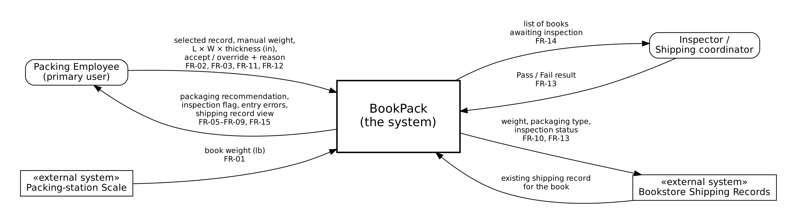

# P1 Section 2.1 Product Perspective and Context

BookPack covers one job: deciding how each book should be packed. Inside the system, it takes a book's weight and size, recommends the packaging, flags heavy books for inspection, and saves the result to the book's shipping record. Everything physical stays outside the system: the scale, measuring, packing and inspecting the book are done by people or existing equipment. The packing employee and the inspector use BookPack directly. The scale and the bookstore's shipping records are existing systems that BookPack reads from or updates, not things it builds. Delivery, tracking and payment happen after packing and are handled by other services, so they are also left out.
