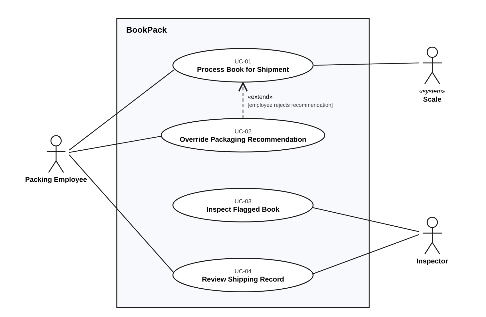

# P1 Section 3.4 Initial Use Cases

## Use case diagram

## UC-01 Process Book for Shipment

| Field | Content |
|---|---|
| Identifier and name | UC-01 Process Book for Shipment |
| Primary actor | Packing Employee |
| Supporting actors | Scale («system» actor) |
| Preconditions | The employee is at the packing station with the book. A shipping record already exists for the book and the scale is connected. |
| Trigger | The employee selects the shipping record for the certain book to be packed. |

**Main success scenario**

1. The packing employee selects the existing shipping record for the book to be processed.
2. The employee places the item onto the connected digital scale.
3. The connected scale automatically transmits weight data, which displays on the user interface (FR-01).
4. The system validates the captured weight against carrier threshold limits (FR-09).
5. The employee manually enters the physical dimensions (length, width, and thickness in inches) into the system (FR-03).
6. The system classifies the item size tier according to defined dimension thresholds (FR-04).
7. The system generates a recommended packaging type, such as cardboard or padded mailers (FR-05, FR-06, FR-07).
8. The system checks weight parameters and confirms the parcel does not require additional inspection.
9. The employee confirms and accepts the system-recommended packaging option.
10. The system updates the shipping record with weight details, selected packaging, and inspection status.

**Alternative and exception flows**

- **3a.** If no automated scale reading is received, the packing employee manually submits the weight entry (FR-02) and resumes execution at step 4.
- **4a.** If the captured weight is less than or equal to 0 lb or exceeds 70 lb, the system displays an error message without persisting data (FR-09) and returns to step 2.
- **8a.** If the item weight exceeds 5.0 lb, the system flags the item for mandatory review (FR-08); step 10 records its status as awaiting inspection, preventing shipment authorization until UC-03 logs a pass result (FR-13).
- **9a.** If the employee rejects the system-suggested packaging, the workflow invokes UC-02 Override Packaging Recommendation (FR-11, FR-12) before advancing to step 10.

| Field | Content |
|---|---|
| Postconditions | Shipping records hold the book's packing type, weight, and inspection status. An unflagged book is ready to ship; a flagged book needs to wait for inspection. |
| Requirements realised | FR-01, FR-02, FR-03, FR-04, FR-05, FR-06, FR-07, FR-08, FR-09, FR-10 |

## UC-03 Inspect Flagged Book

| Field | Content |
|---|---|
| Identifier and name | UC-03 Inspect Flagged Book |
| Primary actor | Inspector |
| Supporting actors | None |
| Preconditions | At least one book has an inspection status of "awaiting inspection" (from UC-01). The user is acting in the inspector role. |
| Trigger | The inspector opens the list of books that need to be inspected. |

**Main success scenario**

1. The inspector requests a report for the books pending inspection.
2. The system shows all flagged books along with their weight, dimensions, and type of packaging.
3. The inspector chooses any book.
4. The inspector verifies the book and the package physically. This happens outside the system.
5. Pass status (FR-13) is written by the inspector.
6. The result is saved by the system in the shipping records and the book is marked ready for shipment (FR-13).
7. The book is taken out of the waiting list by the system and the confirmation is provided.

**Alternative and exception flows**

- **1b.** There are no stored books ready for inspection; the system displays an empty list, indicating the end of the use case.
- **5b.** The inspector logs that the book has failed inspection, causing the system to register a failure and stop the book from the shipping process according to FR-13. No specification exists for what may happen afterwards (see Q4). One can suppose that the book is sent back to the packager for repackaging using UC-01.
- **6b.** The user attempts to mark a flagged book as ready for shipping before a pass can be recorded, but the system does not allow it (FR-13).

| Field | Content |
|---|---|
| Postconditions | Inspection result is saved in the shipping record; a passed book is good to ship and a failed book is still blocked. In both cases the book is no longer on the waiting list to be inspected. |
| Requirements realised | FR-13, FR-14 (it also consumes the flag set by FR-08) |
