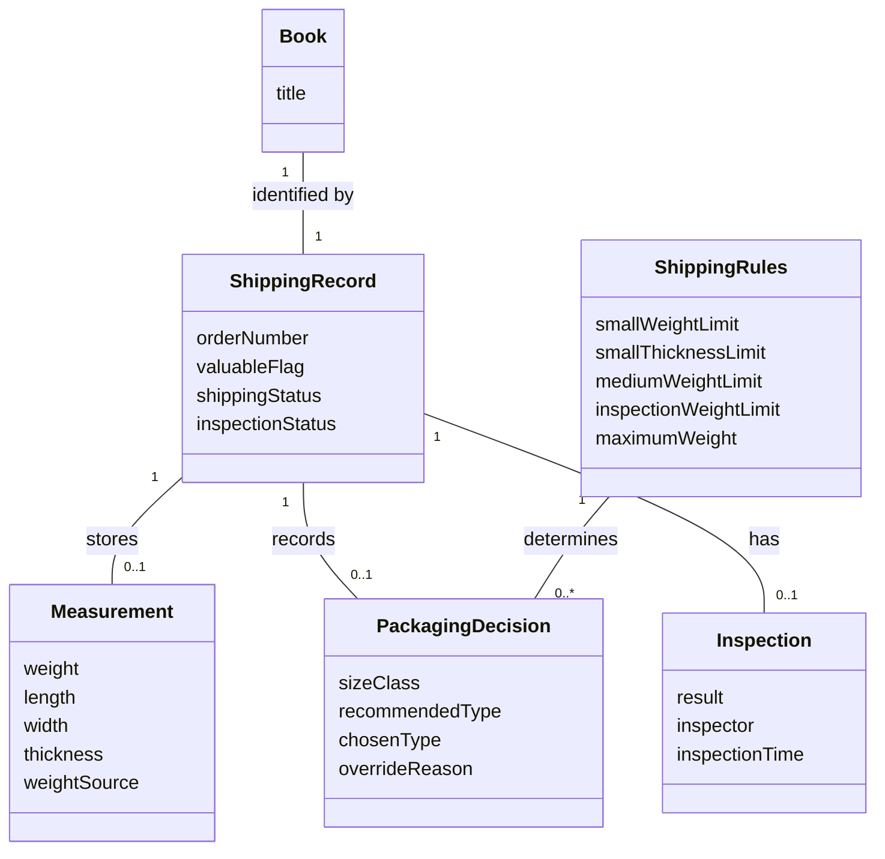

# BookPack Domain Model

## Section 5.1 — UML Domain Model

Figure 5.1 — BookPack Conceptual Domain Model

The domain model shows the conceptual classes, attributes,
associations, and multiplicities used by BookPack.
