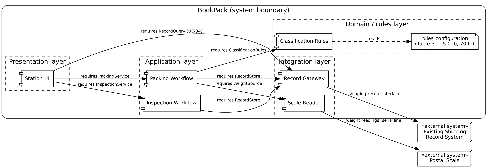
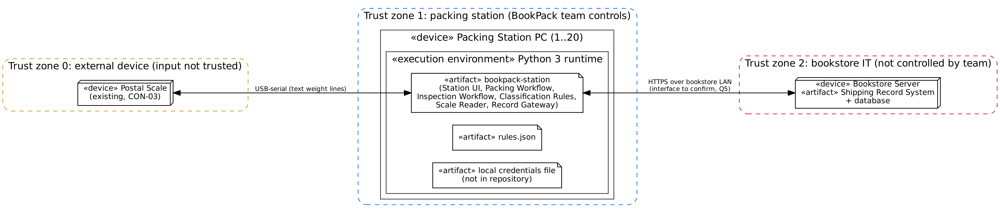

# P2 Section 6 High-Level Design (Architecture)

Owner: Ahmet Keles

BookPack is a layered application that runs on each packing-station PC. It reads the scale directly (ADR-02), keeps classification thresholds in a configuration file (ADR-03), and reaches the bookstore's existing shipping records through one Record Gateway component. ADR-01 records the style decision.

## 6.1 Architectural drivers: quality-attribute scenarios

| QAS | Quality attribute | Stimulus | Artifact | Response | Response measure | From |
|---|---|---|---|---|---|---|
| QAS-01 | Performance | An employee enters the last dimension while up to 20 stations are in use | Packing Workflow and Classification Rules | Shows size class, recommendation and flag | 95% within 3 s over one working week; scale read uses at most 1.05 s of that (S-01 p95) | QR-01 |
| QAS-02 | Availability | The scale stops sending or is unplugged during weighing | Scale Reader | Detects the loss and switches to manual entry with no work lost | Detected within 1.5 s; system usable 99% of business hours over 30 days | QR-03 |
| QAS-03 | Correctness | A 200-book test set, including books on every Table 3.1 and 70 lb boundary, is processed | Classification Rules | Returns the class, packaging type and flag | At least 98% match the expected table; 100% of books over 70 lb rejected | QR-02 |
| QAS-04 | Modifiability | The bookstore changes a Table 3.1 threshold after answering Q1 | Rules configuration | New threshold takes effect with no code change | Changed and boundary-retested in under 1 hour, touching one file | QR-02, A4 |

Constraints that shape the architecture: CON-03 (existing PC and scale) puts all BookPack components on the station PC with no new server; CON-01 and CON-02 put the 70 lb rule and units in one Classification Rules component so they are checked in one place.

## 6.2 Architectural style and alternatives

| Style considered | Drivers it serves | What it costs | Verdict |
|---|---|---|---|
| Layered (presentation, application, rules, integration) with client-server access to the shipping record system | QAS-01 (in-process calls, no network hops except the final save); QAS-04 (rules isolated in one layer); QAS-02 (scale isolated in the integration layer) | Some pass-through calls between layers; one deployment per station to update | Chosen |
| Microservices (scale, rules, records as separate services) | Independent deployment of each part | Network calls inside a 3 s budget; a server to run them, against CON-03; far more operations work than 6 small components need | Rejected |
| Pipe-and-filter (weight → validate → classify → flag → save) | Matches the straight-line part of UC-01 | Override (UC-02), manual fallback and inspection (UC-03) loop back or wait for a person, which a one-way pipeline does not handle | Rejected |

We chose a layered design because every BookPack use case is a short request the employee waits for, so the 3 s budget in QAS-01 favors in-process calls over network hops. Isolating the classification rules in their own layer serves QAS-03 and QAS-04: rules are tested and changed in one place. Isolating the scale and the record system in an integration layer serves QAS-02 and contains the hardware risk from Q3. ADR-01 records this decision.

## 6.3 Component view

Figure 6.3 Component diagram (source: diagrams/component.dot)

| Component | Responsibility | Provides | Requires | Answers to (UC / QAS / ADR) |
|---|---|---|---|---|
| Station UI | Shows the packing and inspection workflows and collects input | — (actor-facing) | PackingService, InspectionService, RecordQuery | UC-01 to UC-04, QR-04 |
| Packing Workflow | Runs UC-01 and UC-02 from weighing to saving | PackingService | WeightSource, ClassificationRules, RecordStore | UC-01, UC-02, QAS-01 |
| Inspection Workflow | Runs UC-03: lists flagged books and records Pass or Fail | InspectionService | RecordStore | UC-03, FR-13, FR-14 |
| Classification Rules | Decides size class, packaging type, flag and weight validity from the rules configuration | ClassificationRules | rules configuration file | QAS-03, QAS-04, ADR-03, CON-01 |
| Scale Reader | Returns a stable weight or reports that the scale is unavailable | WeightSource | Postal scale serial line | QAS-02, ADR-02, S-01 |
| Record Gateway | Reads and updates the bookstore's existing shipping records | RecordStore, RecordQuery | Shipping record system interface | FR-10, FR-15, ADR-01 |

External systems outside the boundary: Postal Scale and the Existing Shipping Record System.

## 6.4 Deployment view

Figure 6.4 UML deployment diagram (source: diagrams/deployment.dot)

| Node | What runs on it | Communicates with (protocol) | Trust zone |
|---|---|---|---|
| Packing Station PC (1 to 20), Python 3 runtime | bookpack-station artifact (all six components), rules.json, local credentials file kept out of the repository | Postal scale (USB-serial, text lines); Bookstore server (HTTPS over the store LAN) | Zone 1: controlled by the team |
| Postal Scale (existing) | Scale firmware | Station PC (USB-serial) | Zone 0: external device; every reading is validated (ADR-02, FR-09) |
| Bookstore Server (existing) | Shipping record system and its database | Station PCs (HTTPS; exact interface open, Q5) | Zone 2: bookstore IT, not controlled by the team |

Trust boundaries: scale → station (untrusted device input, filtered by Scale Reader) and station → bookstore server (authenticated with a station account; credentials stay in local configuration). No cloud service is used, so there is no shared-responsibility split. The inspector uses a station PC in the inspector role (Q6).

## 6.5 From analysis to architecture

| Analysis object (5.1, 5.2) | Component that owns it (6.3) | Note |
|---|---|---|
| PackingController | Packing Workflow | — |
| InspectionController | Inspection Workflow | — |
| ScaleReader | Scale Reader | Wraps the external scale |
| ShippingRules, SizeClass, PackagingType | Classification Rules | Merged: all are rule data loaded from rules.json |
| Measurement, PackagingDecision, Inspection | Packing Workflow (created); Inspection Workflow updates Inspection | Split: created in the workflows, stored through Record Gateway |
| ShippingRecord, Book | Record Gateway | External: owned by the bookstore's shipping record system |
| PackingEmployee, Inspector | Station UI | Actors; identity comes from the station login |

## 6.6 Design principles applied

| Principle | Where it shows in our design | Evidence |
|---|---|---|
| Separation of concerns | Rules, scale access and record access are separate components | 6.3; ADR-01 |
| Information hiding | The scale's line format is known only to Scale Reader; the record system's interface only to Record Gateway | WeightSource, RecordStore; ADR-02 |
| Low coupling | Workflows depend on interfaces, not on the scale or record system | 6.3 Requires column |
| High cohesion | Classification Rules holds every threshold and nothing else | ADR-03 |
| Design for change | Thresholds live in rules.json because Q1 may change them; the scale parser can be swapped when Q3 is answered | QAS-04; ADR-02, ADR-03 |
| Keep it simple (KISS) | One process per station, no server or broker added | ADR-01; CON-03 |
