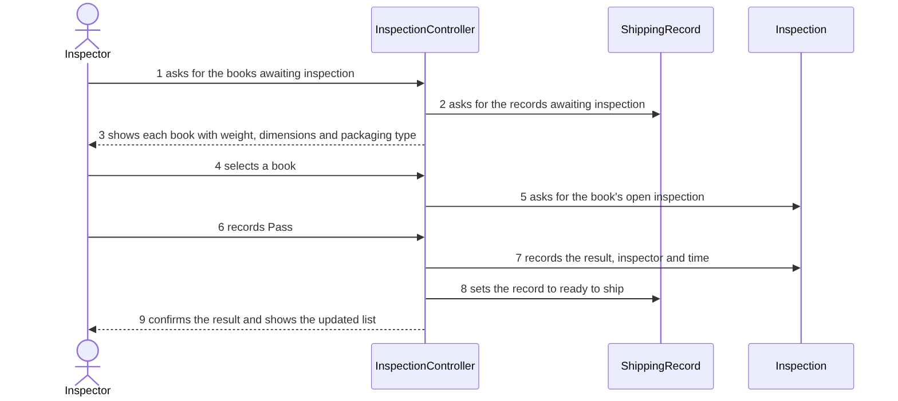

# UC-03 Inspect Flagged Book (P2 sections 4.2, 4.3 and 5.2.2)

Owner: Ahmet Keles

## 4.2 Expanded use case

| Field | Value |
|---|---|
| Primary actor | Inspector |
| Supporting actors and external systems | Existing shipping record system (external system) |
| TUCBW | The inspector asks for the books awaiting inspection |
| TUCEW | The inspector sees confirmation that the result was saved and the book is no longer on the awaiting list |
| Preconditions | The user is acting as the inspector (A3, Q2). |
| Postconditions | The result is in the shipping record. A passed book is ready to ship; a failed book stays blocked. The book leaves the awaiting list. |
| Traces to requirements | FR-13, FR-14, FR-10; consumes FR-08 |

| Actor input / action | System response |
|---|---|
| | (0) The system shows how many books are awaiting inspection. |
| (1) The inspector asks to see the books awaiting inspection. | (2) The system lists each flagged book with order number, title, weight, length, width, thickness and packaging type. |
| (3) The inspector selects a book. | (4) The system shows that book's details and asks for Pass or Fail. |
| (5) The inspector records Pass. | (6) The system saves Pass, marks the book ready to ship, removes it from the list and confirms. |

The physical check of the book happens between (4) and (5), outside the system.

| Alternate flow | At step | Condition | What happens | Ends or rejoins at |
|---|---|---|---|---|
| A1 | (2) | No book is awaiting inspection | The system says no books are awaiting inspection | Ends |
| A2 | (5) | The inspector records Fail | The system saves Fail, keeps the book blocked and marks it for repackaging (assumed, Q4) | Ends after confirmation |
| A3 | (6) | The result cannot be saved | The system says the result was not saved; the book stays on the list | Rejoins (5) |

## 4.3 Self-review rows for UC-03

| Use case | Check from the Lesson 13 review checklist | Defect found | How it was fixed |
|---|---|---|---|
| UC-03 | Precondition or alternate flow | P1 precondition "at least one book awaiting inspection" can be false during normal work | Moved to A1 (empty list) |
| UC-03 | No background processing | P1 step 4 (physical check) was not a system turn | Removed from the table; noted outside it |
| UC-03 | Step (0) present | P1 had no step (0) | Added: count of books awaiting inspection |
| UC-03 | Acknowledgment at end | P1 ended with confirmation; kept | No defect |

## 5.2.2 Object interaction model

(a) Non-trivial steps. (2) finds the records awaiting inspection; (6) records the result and changes the record's status. (0) shows a count; (4) shows details already listed; (1), (3), (5) are actor inputs.

(b) Scenario table

| Step | Subject (who acts) | Subject action | Other data / objects | Object acted upon |
|---|---|---|---|---|
| 1 | Inspector | asks for the books awaiting inspection | — | InspectionController |
| 2 | InspectionController | asks for the records awaiting inspection | status | ShippingRecord |
| 3 | InspectionController | shows each book with weight, dimensions and packaging type | Measurement, PackagingDecision | Inspector |
| 4 | Inspector | selects a book | order number | InspectionController |
| 5 | InspectionController | asks for the book's open inspection | order number | Inspection |
| 6 | Inspector | records Pass | result | InspectionController |
| 7 | InspectionController | records the result, inspector and time | Pass, Inspector | Inspection |
| 8 | InspectionController | sets the record to ready to ship | status | ShippingRecord |
| 9 | InspectionController | confirms the result and shows the updated list | — | Inspector |

(c) Analysis sequence diagram

Figure 5.2.2 Analysis sequence diagram for UC-03; message numbers match the scenario table (source: diagrams/seq-uc03.mmd)

InspectionController is an interaction object that controls UC-03.
